# ⚡ Awesome Static Site Generators (SSG) & Jamstack Ecosystem

**The Definitive, Curated Directory of Modern Static Site Generators, Jamstack Frameworks, Headless CMS Platforms & Edge Web Publishing Engines.**

  
  
  
  
  
  
  

---

*Explore top-tier static site generators (SSGs) transforming plain text, Markdown, MDX, and structured content into pre-rendered, lightning-fast HTML/CSS/JavaScript websites. Version-controlled with Git, zero server maintenance, ultra-secure, and globally distributable across edge CDNs.*

---

## 📑 Table of Contents

- [🌐 Sector Overview & Market Dynamics](#-sector-overview--market-dynamics)
- [🏢 SaaS & Hosted Website Building Platforms](#-saas--hosted-website-building-platforms)
- [🚀 Top Open-Source Static Site Generators](#-top-open-source-static-site-generators)
  - [⭐ Open-Source Ranked by GitHub_Stars](#-open-source-ranked-by-github-stars)
  - [🔍 Detailed Framework Breakdowns](#-detailed-framework-breakdowns)
- [📊 Architectural Comparison & Decision Matrix](#-architectural-comparison--decision-matrix)
- [🛠️ Key Evaluation Criteria for SSGs](#️-key-evaluation-criteria-for-ssgs)
- [🤝 How to Contribute](#-how-to-contribute)
- [⭐ Star History](#-star-history)
- [💖 Support & Sponsorship](#-support--sponsorship)
- [📜 Disclaimer](#-disclaimer)

---

## 🌐 Sector Overview & Market Dynamics

The global **Static Site Generator (SSG)** and **Jamstack / Modern Web Content Management** software sector represents one of the fastest-evolving categories in developer infrastructure and digital publishing. As of **2024**, the market is valued at approximately **$4.8 Billion** and is projected to exceed **$11.6 Billion by 2032**, registering a compound annual growth rate (**CAGR of ~11.8%**). 

The industry exhibits a **bifurcated, moderately-to-highly fragmented market structure**:
- **Consumer & Non-Technical SMB Layer (Concentrated / Winner-Take-Most)**: Dominated by massive platforms such as Shopify ($100B+ market cap) and Wix/Squarespace, where enterprise distribution, integrated hosting, drag-and-drop design, and end-to-end commerce create strong moats and winner-take-most dynamics.
- **Developer-Centric Jamstack & SSG Layer (Highly Fragmented)**: The developer, technical writing, and software documentation tier is fiercely competitive and fragmented across diverse programming ecosystems (Go, Rust, JavaScript, TypeScript, Python, Ruby). Meta-frameworks like **Next.js**, **Astro**, **Hugo**, **Nuxt**, and **Docusaurus** continuously push paradigms—shifting from monolithic builds toward hybrid island architectures, incremental static regeneration (ISR), and edge-rendered micro-frontends with no single vendor monopolizing developer mindshare.

---

## 🏢 SaaS & Hosted Website Building Platforms

The table below provides a comprehensive comparison of leading SaaS and managed website building platforms. Platforms are sorted in **descending order by company size (Valuation / Market Capitalization / Annual Revenue)**.

| 🏢 Platform | 💰 Company Valuation / Revenue | 🏷️ Specific Starting Tier Price | 🎁 Exact Free Tier / Trial Limit | 🎯 Category Focus & Core Strengths |
| :--- | :--- | :--- | :--- | :--- |
| **[Shopify](https://www.shopify.com/)** | **~$105 Billion** Market Cap *(Public: NYSE: SHOP; ~$7.06B Annual Revenue)* | **$39/month** *(Basic plan billed monthly)* or **$29/month** *(billed annually)* | **3-day free trial** *(full store features, no credit card required)* + **$1/month** promotion for first month | Leading enterprise e-commerce platform & checkout engine. Ideal for commercial storefronts requiring integrated payments, global logistics, and app ecosystems. |
| **[HubSpot Content Hub](https://www.hubspot.com/products/cms)** | **~$31 Billion** Market Cap *(Public: NYSE: HUBS; ~$2.17B Annual Revenue)* | **$20/month/seat** *(Starter plan billed monthly)* or **$15/month/seat** *(billed annually)* | **Free Forever Plan**: Up to 25 website pages, 100 blog posts, 1 custom domain, 500MB file storage, and HubSpot-branded badges | Inbound marketing CMS integrated directly into HubSpot CRM. Best for marketing departments creating landing pages and lead-generation funnels. |
| **[Wix](https://www.wix.com/)** | **~$10 Billion** Market Cap *(Public: NASDAQ: WIX; ~$1.56B Annual Revenue)* | **$17/month** *(Light plan billed monthly)* | **Free Forever Plan**: 500MB cloud storage, 500MB bandwidth, `.wixsite.com` subdomain, Wix top/bottom banner advertisements | Visual drag-and-drop website creation with unstructured free-form editing. Great for rapid SMB websites without coding requirements. |
| **[WordPress.com](https://wordpress.com/)** *(Automattic)* | **~$7.5 Billion** Valuation *(Privately held; ~$300M+ Annual Revenue)* | **$4/month** *(Personal plan billed annually at $48/year)* | **Free Forever Plan**: 1GB storage space, free `.wordpress.com` subdomain, basic Jetpack features, community support, WordPress ads | Managed hosting for the world's most ubiquitous blogging engine. Offers seamless migration path to self-hosted WordPress.org. |
| **[Squarespace](https://www.squarespace.com/)** | **~$6.9 Billion** Valuation *(Acquired by Permira; ~$1.0B+ Annual Revenue)* | **$16/month** *(Personal plan billed annually)* or **$25/month** *(billed monthly)* | **14-day free trial**: Access to all premium design templates, style editors, full CMS functionality, and zero credit card required | Award-winning typography, designer templates, and portfolio publishing. Ideal for creative agencies, photographers, and boutique brands. |
| **[Webflow](https://webflow.com/)** | **~$4.0 Billion** Valuation *(Privately held; ~$130M+ ARR)* | **$14/month** *(Basic plan billed annually)* or **$18/month** *(billed monthly)* | **Free Forever (Starter) Plan**: 2 unhosted pages, 50 CMS items, 1GB monthly bandwidth, published to `webflow.io` staging domain | Visual low-code development environment that produces production-ready semantic HTML, CSS, and JavaScript with animation triggers. |
| **[Acquia Cloud (Drupal)](https://www.acquia.com/)** | **~$1.0 Billion** Valuation *(Acquired by Vista Equity; ~$300M+ ARR)* | **$350/month** *(Acquia Cloud Platform Starter tier billed annually)* | **30-day free sandbox trial**: 1 non-production sandbox application, 1GB database and file storage, developer documentation access | Enterprise-grade digital experience platform and managed cloud hosting built specifically for complex open-source Drupal deployments. |
| **[Jimdo](https://www.jimdo.com/)** | **~$400 Million** Valuation *(Privately held; ~$50M+ ARR)* | **$9/month** *(Start plan billed annually)* | **Free Forever (Play) Plan**: Up to 5 website pages, 500MB storage, 2GB bandwidth, free `.jimdosite.com` subdomain | AI-driven website builder designed for European and international self-employed freelancers and micro-businesses. |
| **[Weebly](https://www.weebly.com/)** *(Block / Square)* | **$365 Million** Acquisition Valuation *(Parent Block Inc: ~$40B Market Cap)* | **$10/month** *(Personal plan billed annually)* or **$13/month** *(billed monthly)* | **Free Forever Plan**: 500MB storage, free SSL certificate, Weebly branded subdomain, Square checkout integration | Accessible, lightweight site builder with straightforward e-commerce capabilities tailored for local shops and small sellers. |
| **[Ghost(Pro)](https://ghost.org/)** | **~$15 Million** ARR *(Independent, 100% Bootstrapped Non-Profit Foundation)* | **$9/month** *(Starter plan billed annually for up to 500 members)* or **$11/month** *(monthly)* | **14-day free trial**: Complete access to Ghost(Pro) hosting, newsletter delivery, member management, and custom themes without credit card | Modern membership, paid newsletter, and independent editorial publishing. Built on the open-source MIT-licensed Ghost platform. |

---

## 🚀 Top Open-Source Static Site Generators

Open-source static site generators empower developers to maintain 100% content ownership, avoid proprietary vendor lock-in, automate continuous integration via Git hooks, and publish globally across edge CDNs.

### ⭐ Open-Source Ranked by GitHub_Stars

Below is the verified ranking of top open-source static site generators and documentation frameworks, sorted in **descending order by GitHub Stars_Count**. Each Stars_Badge links directly to that repository's stargazers page:

1. ⚛️ **[Next.js](https://github.com/vercel/next.js)**  — React framework powering hybrid SSG, Server Components, and edge routing.
2. ⚡ **[Hugo](https://github.com/gohugoio/hugo)**  — The world's fastest Go-based static engine (~1ms per page build times).
3. 🦖 **[Docusaurus](https://github.com/facebook/docusaurus)**  — Meta's React-based documentation powerhouse with i18n and versioning.
4. 🚀 **[Astro](https://github.com/withastro/astro)**  — Modern web framework pioneering Islands Architecture and zero-JS defaults.
5. 💚 **[Nuxt](https://github.com/nuxt/nuxt)**  — The intuitive Vue.js framework supporting static site generation and ISR.
6. 🟣 **[Gatsby](https://github.com/gatsbyjs/gatsby)**  — React and GraphQL static site generator with an extensive plugin registry.
7. 👻 **[Ghost](https://github.com/TryGhost/Ghost)**  — Professional Node.js headless publishing platform with native newsletters.
8. 🧪 **[Jekyll](https://github.com/jekyll/jekyll)**  — The Ruby pioneer that started Jamstack, natively integrated with GitHub Pages.
9. 🔮 **[Hexo](https://github.com/hexojs/hexo)**  — Ultra-fast, modular Node.js blogging framework with vast theme ecosystem.
10. 📝 **[Slate](https://github.com/slatedocs/slate)**  — Clean, responsive, three-column API documentation generator in Ruby.
11. 📄 **[Docsify](https://github.com/docsifyjs/docsify)**  — Lightweight, dynamic documentation site generator without static HTML build steps.
12. 🎨 **[Material for MkDocs](https://github.com/squidfunk/mkdocs-material)**  — State-of-the-art documentation theme and SSG distribution for MkDocs.
13. 🐍 **[MkDocs](https://github.com/mkdocs/mkdocs)**  — Fast, simple, Python-powered static documentation generator configured via YAML.
14. 🧡 **[SvelteKit](https://github.com/sveltejs/kit)**  — Official Svelte meta-framework with adapter-static for zero-virtual-DOM outputs.
15. 🎈 **[Eleventy (11ty)](https://github.com/11ty/eleventy)**  — Zero-client-JS Node.js static site generator with multi-language templating.
16. ⚡ **[VitePress](https://github.com/vuejs/vitepress)**  — Vite-powered static site generator from the Vue team for high-speed documentation.
17. 🦀 **[Zola](https://github.com/getzola/zola)**  — Blazing-fast, single-binary static site generator crafted in Rust with Tera templates.
18. 💎 **[Quartz](https://github.com/jackyzha0/quartz)**  — Publish digital gardens and Obsidian Markdown vaults directly as fast static websites.
19. 🐧 **[Pelican](https://github.com/getpelican/pelican)**  — Python static site generator supporting Markdown and reStructuredText with Jinja2.
20. 🔨 **[Metalsmith](https://github.com/metalsmith/metalsmith)**  — An extremely pluggable, simple Node.js static site and directory manipulation engine.
21. 🖥️ **[Publii](https://github.com/GetPublii/Publii)**  — Desktop static CMS application with visual WYSIWYG editing for offline authoring.
22. 💎 **[Middleman](https://github.com/middleman/middleman)**  — Established Ruby static site generator utilizing all modern web development shortcuts.
23. ⚛️ **[Phenomic](https://github.com/MoOx/phenomic)**  — Modular website compiler for React and modern JavaScript ecosystems.
24. 🦕 **[Lume](https://github.com/lumeland/lume)**  — Fast and flexible static site generator built for Deno with zero-dependency TypeScript.
25. 🧩 **[Nanoc](https://github.com/nanoc/nanoc)**  — Highly customizable Ruby tool that transforms raw content into polished websites.
26. ⚙️ **[Cobalt](https://github.com/cobalt-org/cobalt.rs)**  — Static site generator written in Rust designed for simplicity, speed, and safety.
27. 🌉 **[Bridgetown](https://github.com/bridgetownrb/bridgetown)**  — Next-generation Ruby web framework with esbuild, SSR, and Jamstack static compilation.

---

### 🔍 Detailed Framework Breakdowns

#### 1. [Next.js](https://nextjs.org/) (React / Node.js)
- **Architecture**: Hybrid Static Generation (SSG), Incremental Static Regeneration (ISR), and Server Components (RSC).
- **Ideal For**: Large-scale enterprise applications requiring static marketing pages combined with authenticated, dynamic application routes.
- **Key Advantages**: Backed by Vercel; massive ecosystem; seamless transition from static output to edge rendering.

#### 2. [Hugo](https://gohugo.io/) (Go)
- **Architecture**: Single-binary Go compilation with zero external runtime dependencies.
- **Ideal For**: Huge corporate documentation sites, high-frequency publishing blogs, and content repositories containing 10,000+ Markdown pages.
- **Key Advantages**: Benchmark build times under 1ms per page; native Sass/SCSS pipeline; built-in internationalization (i18n).

#### 3. [Docusaurus](https://docusaurus.io/) (React / Meta)
- **Architecture**: MDX-driven React static documentation framework.
- **Ideal For**: Open-source developer tools, product API references, software manual sites, and technical guides.
- **Key Advantages**: Built-in multi-version documentation support; Algolia DocSearch integration; out-of-the-box i18n localization.

#### 4. [Astro](https://astro.build/) (Agnostic / Islands)
- **Architecture**: Component Islands Architecture shipping 0kb client-side JavaScript by default.
- **Ideal For**: Modern content-first websites, developer blogs, portfolios, and marketing sites that need selective interactivity.
- **Key Advantages**: Mix and match React, Vue, Svelte, and Solid components in the same template; type-safe content collections.

#### 5. [Eleventy (11ty)](https://www.11ty.dev/) (Node.js)
- **Architecture**: Lightweight, zero-config Node.js compiler with no client-side JavaScript bundle.
- **Ideal For**: Developers seeking total control over HTML markup without framework overhead or build tool lock-in.
- **Key Advantages**: Supports 10+ template engines (Markdown, Liquid, Nunjucks, Handlebars, Mustache, HTML); remarkably fast build speeds.

#### 6. [MkDocs & Material for MkDocs](https://squidfunk.github.io/mkdocs-material/) (Python)
- **Architecture**: Python-based Markdown to HTML documentation compiler with YAML configuration.
- **Ideal For**: Python library documentation, engineering runbooks, internal corporate wikis, and scientific project guides.
- **Key Advantages**: Gorgeous Material Design theme; instant live-reload dev server; offline search indexing.

#### 7. [Zola](https://www.getzola.org/) (Rust)
- **Architecture**: Single executable written in Rust with built-in Tera templates (Jinja2-compatible).
- **Ideal For**: Developers seeking Hugo-level build velocity with strict Rust memory safety and zero dependency configuration.
- **Key Advantages**: Built-in syntax highlighting, Sass compilation, automated search index generation, and fast pagination.

---

## 📊 Architectural Comparison & Decision Matrix

| Framework / Tool | Primary Language | Rendering Strategy | Client JS Output | Build Velocity | Best Use Case |
| :--- | :--- | :--- | :--- | :--- | :--- |
| **Hugo** | Go | Pure Static (SSG) | 0 KB | ⚡ Blazing (<1ms/page) | Mega-sites (10k+ pages), Developer Blogs |
| **Astro** | JS / TS / JSX | Islands SSG / Hybrid | 0 KB (Opt-in) | 🚀 Very Fast | Content sites, Portfolios, Multi-framework |
| **Next.js** | React / TypeScript | SSG, ISR, SSR | Full React Bundle | ⏱️ Moderate | Web applications with static marketing |
| **Docusaurus** | React / MDX | Static HTML + React | Full React Bundle | ⏱️ Moderate | Versioned Software Docs & Project Wikis |
| **Eleventy (11ty)** | JavaScript | Pure Static (SSG) | 0 KB | ⚡ Fast | Minimalist sites, Content without JS bloat |
| **MkDocs Material** | Python | Static HTML | Minimal JS (Search) | ⚡ Fast | Technical & API Documentation |
| **Zola** | Rust | Pure Static (SSG) | 0 KB | ⚡ Blazing | Standalone fast blogs, Rust-focused teams |
| **Ghost** | Node.js | Headless / Dynamic | Theme Dependent | ⏱️ Fast (API) | Paid newsletters, Editorial memberships |

---

## 🛠️ Key Evaluation Criteria for SSGs

When selecting the optimal static site generator for your engineering or marketing workflow, weigh these critical factors:

1. ⚡ **Build Performance & Scale**: If your site contains tens of thousands of Markdown articles, Go-based (**Hugo**) or Rust-based (**Zola**) engines prevent CI/CD build bottlenecks.
2. 📦 **Client-Side JavaScript Payload**: For maximum SEO scores and Core Web Vitals, prefer zero-JS engines like **Astro** or **Eleventy** over runtime-heavy SPA hydration frameworks.
3. 📝 **Authoring Experience**: If non-technical stakeholders write content, pair your SSG with a visual Git CMS (Decap CMS, TinaCMS, Contentful) or deploy a visual platform like **Ghost** or **Webflow**.
4. 🌍 **Ecosystem & Plugins**: React/Vue developers will feel immediately productive with **Docusaurus**, **VitePress**, or **Nuxt**, leveraging existing component libraries and design systems.
5. 🛡️ **Security & Edge Deployment**: Static HTML files eliminate runtime SQL injection, cross-site scripting vulnerabilities, and database outages—deployable effortlessly to Cloudflare Pages, Vercel, Netlify, or AWS S3.

---

## 🤝 How to Contribute

Contributions to this ecosystem directory are warmly welcomed! Please follow these steps:

1. 🍴 Fork this repository to your GitHub profile.
2. 🌿 Create a feature branch: `git checkout -b feature/add-new-ssg`.
3. ✏️ Add or update tools in `README.md` following the structured tabular or list format.
4. 🔗 Ensure all links are active, descriptions are objective, and Stars_Badges use `style=social&color=white`.
5. 📨 Open a Pull Request with a clear summary of your additions.

---

## ⭐ Star History

---

## 💖 Support & Sponsorship

Thank you for exploring and bookmarking **Awesome-Static-Site-Generators**! If this curated directory saved you research hours or helped you build your next Jamstack project, please consider:

- ⭐ **Starring this repository** to help others discover it.
- 🍴 **Forking and sharing** it with your developer community.
- ☕ **Buying a coffee or sponsoring ongoing open-source curation**:
  
  👉 **[Sponsor on GitHub Sponsor Dashboard](https://github.com/sponsors/ishandutta2007)**

Your generous sponsorship directly supports active maintenance, link audits, and expansion of developer guides across the ecosystem. Thank you! 🙌

---

## 📜 Disclaimer

- This repository is a community-curated directory intended solely for educational, reference, and informational purposes. Mention of specific SaaS platforms or open-source software does not constitute a formal commercial endorsement.
- All product names, logos, trademarks, and registered trademarks belong to their respective corporate owners.
- Benchmark timings, Stars_Counts, market valuations, and pricing tiers reflect public records as of 2026 and may change over time.

---

  Maintained with ❤️ by <a href="https://github.com/ishandutta2007">Ishan Dutta</a> and the global open-source community.

